# Migração de CRM com IA — HubSpot → Magnet Customer

Case de migração de clientes **ativos e cancelados**, reunindo **n8n, APIs REST, JavaScript, enriquecimento por CNPJ e Google Gemini** para reconstruir cadastros e contexto comercial em outro CRM.

## O desafio

Encontrei CRMs com propriedades, entidades e processos diferentes, e a operação no destino era feita registro a registro. Desenvolvi a automação para organizar a extração, o agrupamento, o enriquecimento, a criação de vínculos e a transferência de partes da jornada comercial.

A execução da migração levou quase um dia no ambiente em que trabalhei, envolvendo chamadas e tratamento por registro. Esse tempo reflete minha experiência operacional e não foi medido de forma independente nesta publicação. O fluxo documentado transfere os recortes de histórico descritos nas versões, sem pressupor cobertura integral.

## Arquitetura

```mermaid
flowchart LR
    A[HubSpot: busca e paginação] --> B[Normalização e grupo econômico]
    B --> C[Magnet: criar organização]
    C --> D[Selecionar contas do grupo]
    D --> E[CNPJ e descrição por Gemini]
    E --> F[Magnet: criar negócio e vincular organização]
    F --> G[Notas da jornada: agente HTML]
    G --> H[E-mails: agente HTML]
    H --> I[Reuniões: agente HTML]
    I --> J[Contatos: criar e vincular]
    J --> K[HubSpot: marcar migração]
```

Há **três agentes de formatação HTML em cada versão**, além de uma chamada HTTP ao Gemini para gerar a descrição empresarial. A consulta cadastral de CNPJ é uma etapa distinta do texto gerado por IA.

## Duas versões, uma arquitetura

| Versão | Nós no export | Template |
| --- | ---: | --- |
| Ativos | 71 | [Abrir JSON](workflows/migracao-ativos.template.json) |
| Cancelados | 72 | [Abrir JSON](workflows/migracao-cancelados.template.json) |

Os templates estão **inativos**, sem credenciais, com integrações e agendamento desabilitados. São material de estudo e adaptação; não um pacote conectado ao ambiente de origem. Identificadores, filtros específicos, responsáveis e exemplos reais foram substituídos por marcadores ou dados de demonstração.

## Screenshots

## O que explorar

- [Desafio, entregas e decisões](docs/contexto.md)
- [Paginação e loops](docs/paginacao-loops.md)
- [Agrupamento e transformação](docs/tratamento-dados.md)
- [Entidades, vínculos e mapeamento de campos](docs/entidades-mapeamento.md)
- [Enriquecimento e três agentes de IA](docs/ia-enriquecimento.md)
- [Ativos versus cancelados](docs/variantes.md)
- [Reprocessamento e rastreabilidade](docs/reprocessamento.md)
- [Como configurar](docs/configuracao.md)
- [Inventário e códigos](docs/inventario.md)
- [Preparação pública](docs/publicacao.md)
- [Validação e limites](docs/validacao.md)

## Escopo público

Dois templates, vinte corpos de código extraídos, seis prompts públicos e documentação. Não inclui clientes reais, segredos, IDs de aplicações/usuários, configurações operacionais ou dados de execução. Nenhuma operação foi realizada nos CRMs nesta preparação.
