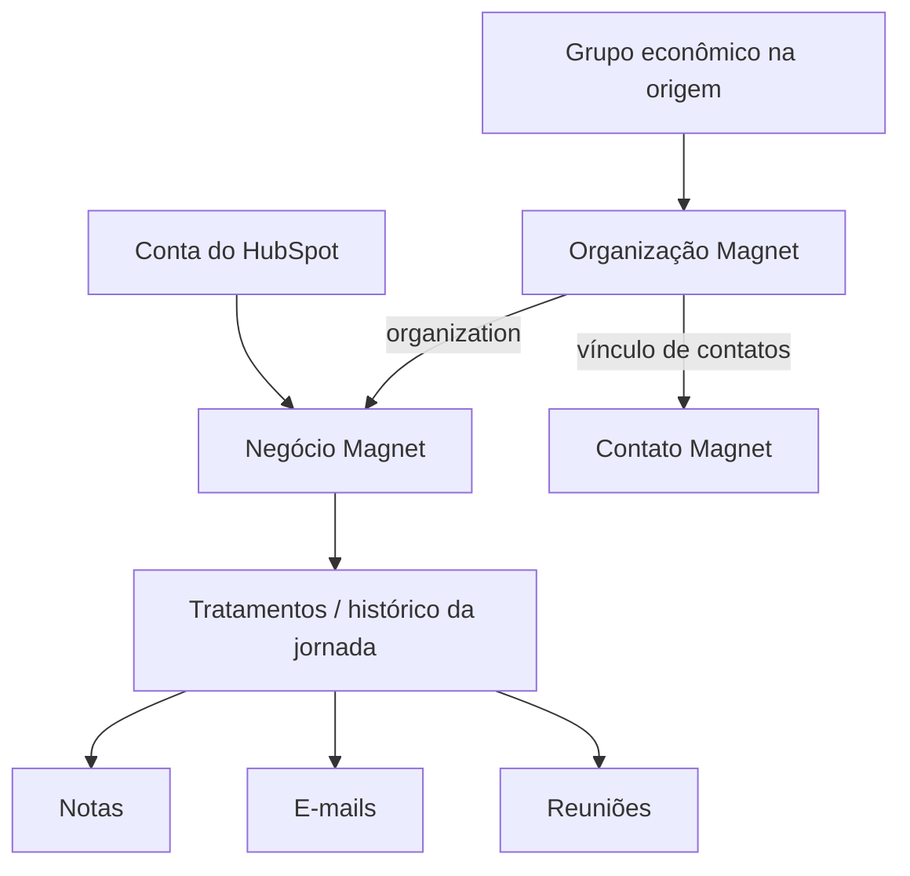

# Entidades e mapeamento

## Estrutura funcional

Este é um mapa funcional dos endpoints e payloads; não representa cardinalidades de um banco relacional.

| Origem / contexto | Destino / uso |
| --- | --- |
| grupo_economico | fullname da organização |
| cnpj_referencia | doc da organização |
| cidade e UF de referência | city e state da organização |
| valor_total | Campo customizado do grupo |
| ID retornado da organização | organizations_id em Set Deal e organization do negócio |
| conta_name | title do negócio |
| valor da conta | amount / campo de receita do negócio |
| hs_object_id / ID da origem | Referência de rastreabilidade em campos customizados |
| Dados do contato HubSpot | Criação do contato e vínculo à organização |
| Saída dos agentes | Registros enviados a treatments |

Pipeline, etapa, observadores, responsáveis e customField dependem do schema de destino. Os IDs foram substituídos de forma consistente por marcadores; configurar autenticação não basta para tornar o template executável.

O endpoint Atualizar HubSpot faz PATCH na origem para marcar a migração. A marca não substitui uma tabela de reconciliação por entidade nem confirma que todas as operações anteriores foram bem-sucedidas.
